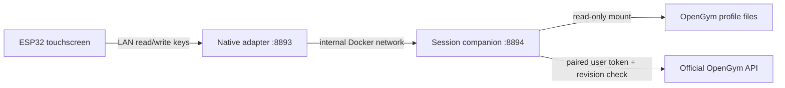

# OpenGym Panel

A self-hosted touchscreen companion for [OpenGym](https://github.com/DuarteSantos8/openGym).
Plan your session, register completed sets and run a rest timer without handling a phone.

**Community source preview · 1.1.32-community.1.** The training workflow has been
used on one installation. The generic installer and community firmware are new;
an independent clean-install and physical touch test are still required before a
stable community release. This is an independent companion, not an official
OpenGym product.

## Screenshots

Native LVGL interface rendered on a desktop with **synthetic profiles and workout
data**. These are not photographs or captured ESP32 framebuffers. The default
original placeholder is shown; no restricted exercise artwork is included.


<details>
<summary>Profile selector</summary>


</details>

See [render provenance and reproduction](docs/DEVELOPMENT.md#readme-renders).

## What it does

- One to eight separately bound profiles, with ordinary OpenGym device pairing.
- Today's plan, routine selection on rest days and native OpenGym prescriptions.
- Actual load/repetition/time entry, independent left/right results and explicit
  set registration. Source routines are not changed by the set editor.
- Confirmed-set progress, automatic rest, exercise navigation and a muscle map.
- Explicit save/discard when finishing; retries do not duplicate workouts.
- Per-profile drafts and retained screen state during short network outages.
- Local brightness, sleep schedule and password-protected browser administration.

The default illustration is original geometric artwork. **Gym visual exercise
images/animations are not included, downloaded or extracted from OpenGym.** See
[media and licences](docs/MEDIA.md) before enabling your own illustrations.

## Supported setup

| Component | Supported baseline |
| --- | --- |
| Display | Guition JC8012P4A1 **v3**, ESP32-P4, 1280×800 landscape |
| Firmware | ESPHome **2026.10.0**, ESP-IDF **5.5.5**, local pinned drivers |
| OpenGym | **1.4.4**, source `5f5832db56080837b58342ff50f78631dcc63e07` |
| Companion host | Linux, Docker Engine + Compose, access to OpenGym data/API |
| UI | Norwegian (`nb`); configurable IANA timezone |

Original/engineering-sample boards, similarly named v2 boards, arbitrary OpenGym
versions and additional languages are not claimed compatible. The legacy files
in `web/`, `preview/`, `firmware/opengym-panel.yaml` and `gym_panel/` are retained
as source/test references, **not alternate supported installation targets**.

## Quick start

1. Read the [installation guide](docs/INSTALL.md) and [hardware notes](docs/HARDWARE.md).
2. Make a private copy of `config/profiles.example.json` and bind your existing
   non-administrator OpenGym profile(s).
3. Run `python3 tools/setup.py --help` on the companion host. It generates unique
   private keys and a Docker Compose installation; it never starts services,
   changes OpenGym data, pairs a person or flashes hardware.
4. Build/start the two companions, provision your Wi-Fi and compile your own
   firmware. Pair each profile from the actual screen.

Do not use the old installation's firmware. No pre-provisioned binaries, account
credentials, household configuration or private Git history are shipped here.

## Architecture



The session service never writes directly to OpenGym's mounted data. Completed
workouts use the official API with revision checking, readback and bounded
recovery copies. The service's own tokens and drafts have a separate private
store. Neither Home Assistant nor OpenClaw is required.

## Boundaries

- Active phone workouts are not mirrored. Programme editing, drop/rest-pause
  logging and per-set notes remain in OpenGym's app.
- There is no offline write queue. A stale/disconnected screen cannot register
  sets as if they had been accepted.
- No calories, heart rate or bodyweight are fabricated by this display.
- Apple Health is an optional **iPhone-app** integration, not a direct ESP32
  upload. A saved panel workout can sync through the same OpenGym profile and
  the native iPhone app; this complete path is not yet physically verified here.
- No machine-specific cable weights are applied by default. An optional
  explicit label table is documented in the installation guide.
- This is a trusted-LAN/VPN service, not an internet-facing dashboard.

## Development

The community edition and the maintainer's installation share
[one development workflow](docs/DEVELOPMENT.md). Source sync is separate from
firmware deployment and never publishes private configuration or training data.

```sh
npm ci --ignore-scripts
python3 -m pip install -r requirements-dev.txt
python3 tools/check.py
```

Firmware compile checking uses synthetic credentials and never uploads to a
device. See [building and recovery](docs/BUILDING.md). Public CI and source
packaging do not require any installation secrets.

## License

Panel software: **AGPL-3.0-or-later**. Vendored OpenGym code retains its AGPL
licence; drivers, font and muscle-map artwork retain their own notices. See
[NOTICE.md](NOTICE.md), [LICENSE](LICENSE) and [upstream provenance](docs/UPSTREAM.md).

Contributions are welcome; please read [CONTRIBUTING.md](CONTRIBUTING.md). Report
security issues privately according to [SECURITY.md](SECURITY.md), without posting
configuration files, tokens, profile IDs or training history.
