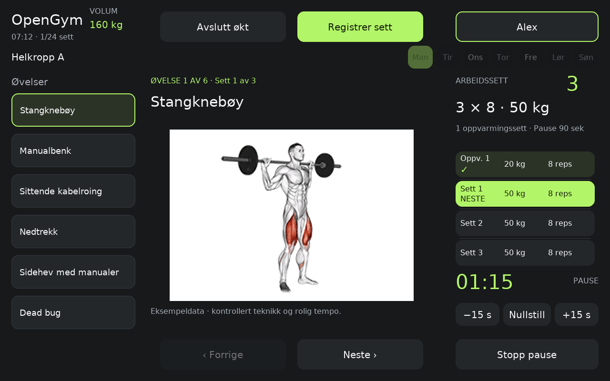
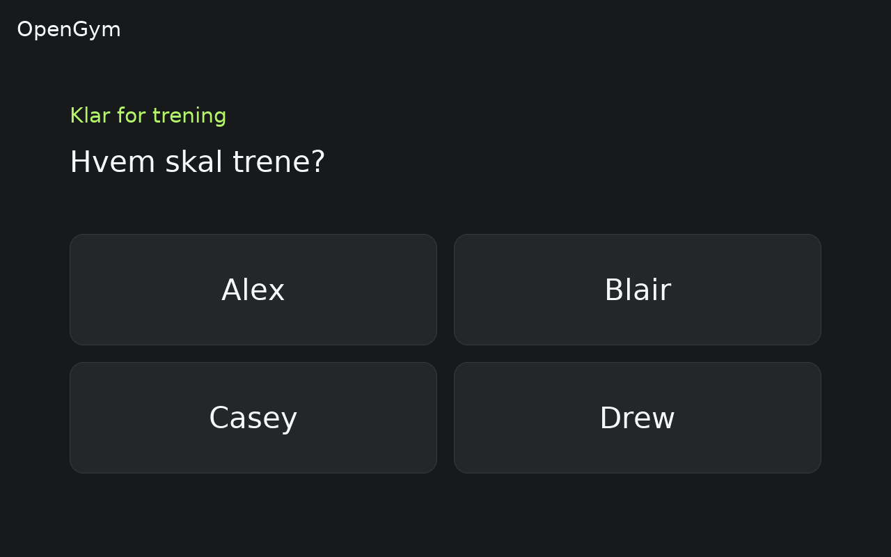
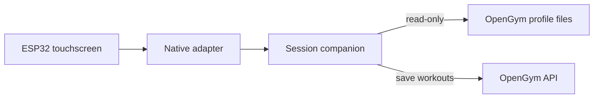

# OpenGym Panel

A touchscreen for your self-hosted [OpenGym](https://github.com/DuarteSantos8/openGym)
setup. Follow your routine, log sets and keep track of rest periods without
picking up your phone.

Built for the Guition JC8012P4A1 v3, with an ESP32-P4 and a 1280×800 display.
This is an independent companion project.

**Status:** Early community release (`1.1.34-community.1`). The training workflow
is in use on one panel; the installer and community firmware still need testing
on other setups.

## Screenshots



<details>
<summary>Profile selection</summary>



</details>

*English desktop renders of the native LVGL interface, using example data.
[Image notes](docs/images/RENDER-NOTICE.md).*

## Features

- Up to eight profiles, each paired with its own OpenGym account.
- Today's plan, with routine selection on rest days.
- Weight, reps or duration entry, including separate left/right results.
- Set progress, a muscle map and an adjustable rest timer.
- Save or discard at the end of a session, with drafts kept through short
  connection outages.
- Brightness and sleep settings through a local, password-protected web page.

Exercise illustrations are optional and aren't bundled. The default is a neutral
placeholder; see [media setup and rights](docs/MEDIA.md) for your own images.

## Requirements

| Component | Supported version |
| --- | --- |
| Display | Guition JC8012P4A1 **v3**, ESP32-P4, 1280×800 |
| OpenGym | Self-hosted **1.4.4** |
| Companion host | Linux with Docker Engine and Compose |
| Firmware | ESPHome **2026.10.0**, ESP-IDF **5.5.5** |
| Interface languages | English (`en`, default) and Norwegian Bokmål (`nb`) |

The panel and companion host need to be on a trusted local network or VPN.
Other boards and OpenGym versions haven't been verified. See the
[hardware guide](docs/HARDWARE.md) before buying a display; similarly named v2
boards are different hardware.

## Installation

The [installation guide](docs/INSTALL.md) covers the full setup. In brief:

1. Make a private copy of `config/profiles.example.json` for your OpenGym users.
2. Generate the companion configuration with `tools/setup.py` on your Linux host.
   English is the default; use `--language nb` for Norwegian.
   Run `python3 tools/setup.py --help` for the available options.
3. Start the companion services, configure Wi-Fi and
   [build the firmware](docs/BUILDING.md) for your panel.
4. Pair each profile from the screen using **Settings → Pair the mobile app**
   in the corresponding OpenGym account.

See [language configuration](docs/LANGUAGES.md) for matching firmware settings.

## How it works

Two small services connect the panel to OpenGym. They read workout plans from
your server and save completed sessions through OpenGym's API.



Programme editing, drop/rest-pause logging and per-set notes stay in OpenGym.
Active phone workouts aren't mirrored, and recording sets requires a connection
to the server. Apple Health sync depends on OpenGym's iPhone app; the complete
panel-to-Health path hasn't been verified.

## Development

```sh
npm ci --ignore-scripts
python3 -m pip install -r requirements-dev.txt
python3 tools/check.py
```

See [development](docs/DEVELOPMENT.md) for the source workflow and
[building and recovery](docs/BUILDING.md) for firmware builds.
Contributions are welcome; start with [CONTRIBUTING.md](CONTRIBUTING.md).
For security issues, use the contact in [SECURITY.md](SECURITY.md).

## License

The panel software is **AGPL-3.0-or-later**. Third-party components and exercise
artwork have their own terms; see [NOTICE.md](NOTICE.md), [LICENSE](LICENSE)
and [upstream provenance](docs/UPSTREAM.md).
